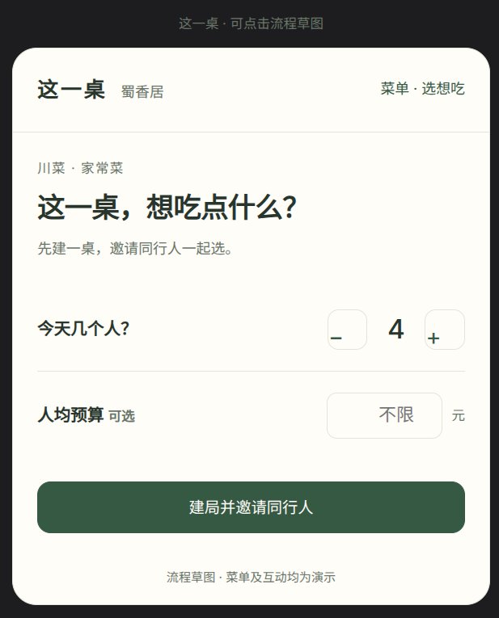
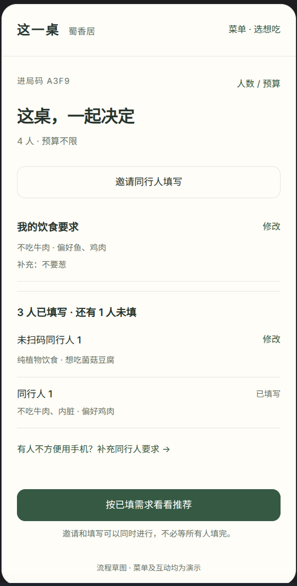
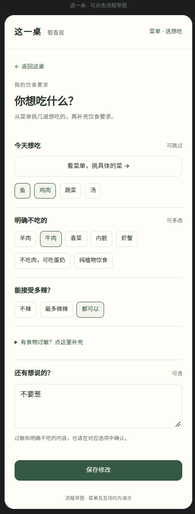
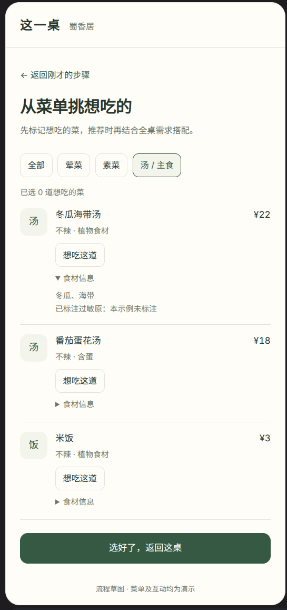
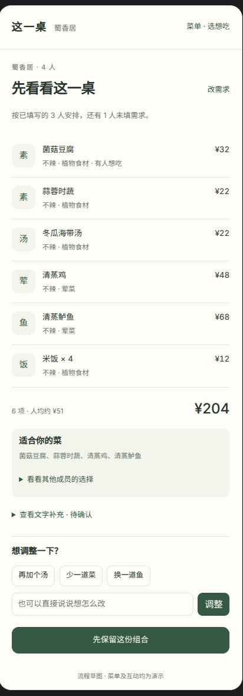

# 多人聚餐智能点菜 · 设计文档

- 日期：2026-10-16
- 更新：2026-10-18
- 状态：本轮用户流程与需求划分已确认；技术栈可用性仍待验证
- 界面参考：可点击草图的单文件演示版位于 `docs/prototypes/group-dining/index.html`；原型源码见同目录
- 本次需求更新：调整菜品属性、加入固定套餐、简化过敏处理、加入 C 端可选登录和个人默认设置，以及提供餐馆与账号入口的主页；现有原型与截图尚未同步这些新增需求
- 2026-10-18 补充：食材支持 `unknown`，表示除已列出食材外仍有未知成分；本轮已确认其筛选、个人适配及套餐处理规则。

## 1. 概述

**产品**：一个解决"多人聚餐点什么菜"的 Web 应用，引入 agent 协助决策。用户可从主页扫码或输入餐馆码进入特定餐馆，也可直接打开餐馆链接；主页同时提供账号入口。发起人建局后即可邀请同行人，各自选择想吃的具体菜品或套餐、填写饮食要求，也可以补充文字。agent 综合人数、已填写成员的要求与预算，搭配一桌共享组合，让每位已填写成员都有合适的选择，并支持对话调整。C 端可登录也可不登录，登录用户可以读取和保存个人默认饮食设置。商家注册账号入驻、在专属界面录入菜品与套餐。

**定位**：创新比赛作品。

**架构语言**：后端采用华为自研仓颉（Cangjie）语言——团队明确决策，兼具"国产自研栈"叙事点；前端为静态 HTML/JS。

**成功标准**：

1. 核心闭环可用：主页扫码 / 输入餐馆码或直接打开餐馆链接 → 餐馆页浏览菜单 / 建局 → 邀请同行人与填写需求（顺序自由）→ 菜单标记想吃 / 文字补充 → agent 推荐 → 对话调整 → 保留或确认组合；聚餐局邀请链接可直接进局
2. 按成员匹配菜品、检查组合覆盖：明确不吃的菜不能算作适合该成员；选择不足或完全没有合适菜品时明确指出，不自动放宽个人限制
3. 降级兜底可演示：LLM 不可用时规则引擎仍能出推荐
4. 商家端完整可用：注册、登录、录入与管理菜品和套餐；C 端访客完整可用，注册登录为可选能力
5. 不显示“忌口 0 违反”徽章；展示具体菜品、适合自己的选择、尚未填写的成员数量和选择不足等必要提示
6. 登录用户可维护默认过敏食物、接受辣度等设置，进入新局时预填；本局临时修改和账号默认设置相互独立
7. 主页可进入账号页；从餐馆或房间进入账号后，返回时保留原位置、房间身份和已填内容，不强制重走主页

**团队与周期**：1~2 人；周期不设死线（原 4 周参考已放宽，里程碑仅作参考）。范围仍按小规模狠收。

## 2. 背景与问题

多人聚餐点菜的痛点：忌口冲突（有人不吃辣、有人不吃香菜）、口味分歧、没人拍板。现有点餐系统只解决"下单"，不解决"决策"。

**创新点**：把"全桌实时协同"与"agent 决策"结合——每个人表达饮食限制和想吃的菜品/套餐，规则引擎先计算“谁适合吃哪些菜”，agent 再组合成整桌菜单。普通忌口按个人匹配：一人素食不要求整桌全部吃素，一人不吃辣不排除其他成员的辣菜。过敏匹配以菜品食材为依据，由规则过滤并由 AI 辅助判断食材关联；本版不建设复杂过敏处理流程。

## 3. 核心概念

| 类别 | 用户表达 | 推荐规则 |
| --- | --- | --- |
| **过敏** | 花生、鱼、虾蟹、鸡蛋、奶、大豆等过敏食物，多选，可来自账号默认设置 | 用户过敏项仍单独记录；菜品不另设过敏原表或资料状态。对食材（含调料/汤底）做匹配过滤，AI 辅助识别同义名称和食材关联；整桌排除已匹配过敏食材；任一已提交成员有过敏要求时，也排除食材含 `unknown` 的菜及包含它的固定套餐 |
| **明确不吃 / 接受范围** | 不吃羊肉、香菜等；不吃肉但可吃蛋奶、纯植物饮食；最大接受辣度 | 个人硬约束。不能把不符合要求的菜计入此人的适配结果，但可以推荐给其他适合的成员；系统和其他成员不能自动替本人放宽 |
| **今天想吃 / 口味偏好** | 从菜单标记具体菜品或套餐；鱼、鸡肉、蔬菜、汤等快捷偏好；清淡等文字表达 | 软目标，尽量满足；标记“想吃”不是下单、锁定条目或要求每项都入选 |

**输入原则**：

- 常见要求以点选为主，食物过敏独立收起展示；无特殊要求的人可直接保存。明确保存空选项才表示“无特殊要求”，未填写不等于没有限制。
- 菜品辣度统一为“不辣、微辣、中辣、重辣”（内部可对应 0-3）；用户设置最大接受辣度，界面也可提供“都可以”表示不设上限，而非新增菜品辣度。辣度不要求整桌统一。
- 用户仍可选择饮食模式：蛋奶素不含肉、鱼、虾蟹等动物肉类，纯植物饮食也排除蛋奶。是否适配由食材推导，AI 可辅助理解；不再让商家单独录入“饮食模式匹配标记”。调料和汤底计入食材信息。
- “还有想说的？”为可选文字补充，当前原型限制 200 字。自由文字不能覆盖已确认的结构化限制。
- 正式产品可由 LLM 整理文字中的偏好与限制，并在个人表单中展示识别出的标签，用户点保存时一并确认；自由文字不能静默删除已有过敏或不吃项。原型目前仅保存和展示文字，未实现模型理解。
- 食材采用可匹配的名称/类别字典。“鱼”“虾蟹”“贝类”等分开定义；AI 可辅助识别食材关联，但不能将明确命中的冲突改为适合。具体菜品愿望与本人限制冲突时说明原因并禁止选入；修改限制后取消冲突愿望并提示。套餐按组分说明个人可选菜，不能因为部分组分不适合就把整套都算作适合或不适合。

**食材中的 `unknown`**（2026-10-18 确认）：

- `ingredients` 仍为字符串数组，可同时包含已知食材和保留值 `unknown`。例如 `["土豆", "青椒", "unknown"]` 表示已知有土豆、青椒，但不知道剩余食材；`["unknown"]` 表示没有已明确的食材。它不是一种食材，也不表示“没有其他食材”。不增加商家需另填的资料状态字段。
- 已知食材照常检查，明确冲突优先于不确定性；不能因为存在 `unknown` 忽略已知的花生、肉类等。AI 可以解释已有食材关联，不能凭菜名、常见做法或猜测补齐未知部分，再将其视为已确认配方；规则降级时使用相同的未知处理。
- **无食材型限制**：在没有整桌过敏排除的前提下，该菜仍可适配没有过敏、不吃食物或素食要求的成员；已填写辣度、可售性等独立条件继续检查，并显示“其余食材不详”。
- **有明确不吃 / 素食要求**：已知食材没有明确冲突但含 `unknown` 时，对该成员记为“食材不完整，暂不计入适合你的菜”，不能计入0/1/2道覆盖统计。可以作为其他适配成员的菜入选；不把信息不足描述成确定含有其不吃食材。
- **有已提交的过敏要求**：沿用整桌排除逻辑，所有含 `unknown` 的菜从本桌推荐候选排除；固定套餐任一组分含 `unknown` 时整套排除。没有命中已知过敏项也不能跳过此规则；不新增餐厅审核或解除流程。
- 无整桌过敏排除时，套餐仍按实际菜逐一检查；未知组分不计入有食材限制成员的覆盖，其他完整食材且适配的组分仍可计入。只有未知项导致覆盖为0时，沿用现有不足提示和完整方案确认限制。
- 菜单展示已知食材及“其余食材不详”，不直接把英文标记当菜料展示。仍可浏览或标记想吃；愿望不能绕过上述筛选/覆盖规则，未入选时说明信息不足或整桌过敏过滤原因。
- 实现约定：去除首尾空白，标记大小写归一为 `unknown`、重复标记合并；空数组或仅空白按 `["unknown"]` 处理，不能借清空食材绕过未知规则。新增/移除 `unknown` 和修改其他食材一样使菜单版本更新、旧推荐失效；只有餐馆明确更新资料才能移除标记，AI不能自动移除。

**推荐空间与覆盖**：

- 先按成员计算适配关系，再选共享菜品；一道菜可以同时适合多位成员，无需每人独立套餐。
- 可推荐候选集包含“至少有实际菜品适合一位已填写成员的可售菜品/套餐”，并执行整桌过敏过滤，而不是取全体个人忌口的交集。服务端依据食材匹配结果计算按人适配、覆盖、可售性和价格，套餐的个人适配按组分展开计算。
- 本轮默认目标：每位已填写成员至少有 2 道适合的非汤、非主食、非饮品菜；这是组合优化目标，不是硬门槛或实际份量保证。仅有 1 道时提示选择较少，0 道时标记该成员尚未被覆盖，不能确认成完整整桌方案。
- 未填写成员计入声明人数和菜量估算，不计入“已适配成员”；登录后预填默认设置也仍需本人提交，才计入已填写人数。
- 过敏处理限定为商家录入食材的基础过滤和 AI 辅助关联判断；不设置过敏原资料状态、制作确认、严重程度、交叉接触或审核解除等流程。AI 不补写商家未录入的配方，也不提供实际食用安全保证。
- 不再因“存在过敏项”而强制所有方案停留在待餐厅确认状态。通过当前食材过滤、满足已填成员覆盖要求且数据版本有效的组合可正常确认；确认表示本桌决定采用该组合。

## 4. 系统架构

**技术栈**：仓颉（Cangjie）后端 + 静态前端。

- 后端语言：华为自研仓颉（SDK 默认 LTS 1.0.5），官方 `net.http` 标准库（HTTP/1.1 / HTTP/2 / WebSocket 服务器），社区备选 [tycj-net](https://gitcode.com/tybb2026/tycj-net/tree/)、[tycj-web](https://gitcode.com/tybb2026/tycj-web/tree/)
- 存储：[sqlite4cj](https://gitcode.com/AlonNas/sqlite4cj/tree/main)（CFFI 封装原生 SQLite，MIT）——W1 须在开发环境验证；**兜底：JSON 文件持久化**（1~2 家店演示规模完全够用）
- LLM：DeepSeek（openai 兼容接口），仓颉 HTTP client + JSON 手写调用，`llm.cj` 适配层可替换
- 前端：Vue 3 + Vite 构建、导出静态产物（默认选型，原生 JS 亦可），由仓颉 server 托管；浏览器原生 WebSocket（不用 socket.io，断线重连由前端手写：指数退避 + 重连后拉全量快照）

```
web/             用户端静态前端（主页/餐馆/房间/账号，Vue 构建产物，由仓颉 server 托管）
web/admin/       商家端静态前端（注册/登录 + 菜品/套餐管理界面）
src/main/        入口：HTTP + WebSocket server（net.http）
src/auth/        商家及 C 端账号会话（注册/登录/密码哈希/权限校验；访客仍可使用 C 端）
src/agent/       agent 层（核心创新点）
  ├─ llm.cj        LLM 适配器（DeepSeek 默认，可替换为其他 openai 兼容服务）
  ├─ rules.cj      规则引擎：纯函数，按人匹配/组合覆盖检查/确定性推荐
  ├─ tools.cj      工具定义（搜菜/查菜/调整推荐）→ function calling
  └─ prompt.cj     提示词
src/store/       SQLite 存储层（sqlite4cj；兜底 JSON 文件）
src/model/       数据模型
```

**关键边界**：

- `rules.cj` 不依赖 LLM，**必须能独立产出确定性推荐**（降级路径与双保险叙事的基础）
- `llm.cj` 不关心业务，只负责"问模型要结构化 JSON"
- 实时层只做房间状态广播，不掺业务逻辑
- 每层可独立理解、独立测试（仓颉内置测试框架）

**生态风险与兜底**（W1 验证项）：

- sqlite4cj 在开发环境不可用 → 换 JSON 文件持久化，接口不变
- `net.http` WebSocket 遇坑 → 换社区 tycj-net / tycj-web
- 存储与网络只是实现替换，不影响上层设计（分层边界的意义所在）

## 5. 数据模型

- **MerchantAccount**：id、用户名、密码哈希（加盐）、restaurantId、创建时间（一个账号绑定一家餐厅，MVP 简化）
- **UserAccount（C 端账号）**：id、登录标识、密码哈希（采用密码登录时）、可选昵称、创建时间。与商家账号权限隔离；业务层通过 userId 关联用户默认设置。
- **UserDefaultSettings（用户默认设置）**：userId、过敏食物[]、明确不吃食物[]、饮食模式、最大接受辣度、可选快捷口味偏好[]、更新时间。只保存本人常用要求，不保存某局“今天想吃”的菜品/套餐、临时文字、人数或预算。
- **Restaurant**：id、ownerId（所属商家账号）、唯一餐馆码 restaurantCode、名称、简介。餐馆入口链接由餐馆码生成，二维码编码同一链接，无需独立二维码业务表；餐馆码与聚餐局短码分别解析，界面明确区分用途。
- **Dish**：id、restaurantId；业务属性为**名称、简介、口味、烹饪方式、当前价格、图片、分类（凉菜/热菜/汤/主食/饮品）、食材[]（含调料/汤底）、辣度（不辣/微辣/中辣/重辣）、是否可售、招牌标记**。食材数组允许已知名称与 `unknown` 混合，语义及规则见第3节。口味可表达清淡、咸鲜、酸甜等倾向，烹饪方式可表达蒸、炒、炖、煮、炸等；价格以服务端当前菜单为准。不另设饮食模式匹配标记、过敏原列表或过敏原资料状态。
- **SetMeal（套餐）**：id、restaurantId；业务属性为**套餐名字、图片、组分[]、价格**。组分按固定菜品及份数表示：`{ dishId, quantity }`；本轮默认一个套餐由同一家餐厅的现有菜品组成，不做自选/换菜套餐。
- **Session（聚餐局）**：id、短码（4~6 位字母数字，如 `A3F9`）、restaurantId、发起人 participantId、状态（open/recommended/closed）、声明人数（本轮原型默认 4，可修改）、可选人均预算、状态版本、创建时间、过期时间（24h TTL 清理）。已加入人数、已提交需求人数和声明人数分别统计。
- **Participant**：id、sessionId、可空 userId（登录时关联）、昵称（默认“成员 N”，可后改）、可选头像色、填写状态（未提交/已提交）、本局过敏食物[]、明确不吃食物[]、饮食模式、辣度上限、快捷偏好[]、想吃菜品 id[]、想吃套餐 id[]、文字补充、加入时间、来源（本人填写/同行人补充）、filledByParticipantId。房间内始终使用 participantId 标识本人，访客会话也能恢复身份；账号默认设置复制为本局需求快照，二者不实时绑定。补充同行人无需强制起名、选头像。
- **Recommendation**：id、sessionId、使用的房间/菜单版本、推荐条目[]（`itemType: dish/setMeal`、itemId、数量、生成时名称/单价）、总价、套餐展开后的实际菜品及份数、每道实际菜对应的适配成员 id[]、事实理由、选择不足/未覆盖成员 id[]、预算提示、生成时间、是否采纳。价格、套餐组成、计价和明确食材冲突由服务端校验，模型判断不能覆盖确定性冲突。
- **ChatMessage**：id、sessionId、sender、role（user/agent）、内容、时间（对话式调整历史，轻量持久化）

**套餐组分与计价约定**：

- 组分不能为空，quantity 为正整数，引用同店有效 dishId；不在套餐中复制另一套名称、食材和辣度。组分菜删除前须先调整引用它的套餐。
- 菜单提供独立“套餐”分区，卡片展示套餐名字、图片和套餐售价，可展开查看各菜及份数；支持标记“想吃”。菜品分类枚举保持上述五类，套餐不混成一条普通 Dish。
- 推荐按组分逐菜判断个人适配：套餐有荤菜不意味着素食成员完全无菜可吃；也不能把一套套餐的所有菜都算作适合该成员。未知组分不计入有食材限制成员的覆盖，其他完整且适配组分仍可计入。若组分命中整桌过敏排除规则（含本桌有过敏要求时的 `unknown`），整套从候选排除，本版不假设可以去掉或替换某个组分。
- 总价为“套餐售价 × 套数 + 额外单点售价 × 份数”；套餐内组分不再次按单点价收费。同一组分重复份数不增加不同菜品的覆盖种类。
- 套餐包含的菜可满足该菜的“想吃”意愿，推荐默认避免再重复加同一道单点；确需加份时明确显示额外数量及价格。
- 任一组分不可售时套餐不可推荐，可售性由组分推导，无需新增套餐业务属性。套餐价格/组分或关联菜品变化都使旧推荐失效。

## 6. 核心流程与实时协议

### 6.1 用户视角主流程

1. 从主页扫码、输入餐馆码，或直接打开餐馆链接，进入对应餐馆页；可先查看菜单、标记想吃，再声明人数和可选人均预算。点“建局并邀请同行人”才创建房间，立即获得聚餐局短码、二维码和进局链接。进入餐馆本身不自动建局，也无需先填发起人的饮食要求；收到邀请的成员直接进入已有房间。
2. 房间中“邀请同行人填写”“我的饮食要求”“菜单 · 选想吃”均可使用。邀请、同行人进局、个人填写没有先后依赖；发起人尚未填写时，其他成员可以先填写。
3. 成员在“今天想吃”中浏览菜单并标记具体菜或套餐，回到表单后保留选择；也可选快捷偏好、明确不吃的食物、辣度和过敏项，以及填写可选文字。已登录者预填个人默认设置，但仍需确认本局要求并保存后才计入已填写人数；访客手动填写同一份表单。
4. 不便扫码者通过可选入口“有人不方便用手机？补充同行人要求”录入，界面以“未扫码同行人”展示；不要求创建带昵称、头像的代理身份，不在主流程强调“由谁代填”。来源和操作权限在服务端记录。
5. 房间简洁展示人数、预算、我的需求和已填写状态；详细偏好按需展开。至少 1 位成员提交后，任一成员可点推荐，不必等人齐；明确告知按多少人的已填需求生成、还有多少人未填。
6. 推荐页区分套餐与额外单点、展示各条售价和总价；套餐可展开组分，“适合自己的菜”依据展开后的实际菜品展示。“其他成员的选择”“文字补充”等作为展开信息。通过快捷操作或文字对话调整，服务端重新计算适配、覆盖与价格。
7. 已填成员全部有选择且数据版本有效时可以确认组合；未齐时仅保留基于已填需求的方案。存在 0 道合适菜的已填成员时可查看部分结果，但不能确认完整方案。过敏基础过滤属于推荐匹配，不新增餐厅审核或确认门禁。
8. 人数、成员需求或菜单发生变化后在原房间重新推荐；无需重新召集、重新扫码。

### 6.2 页面职责与信息层级

| 页面 | 主要操作与信息 | 次级信息 |
| --- | --- | --- |
| 主页 | “扫码进餐馆”主入口、手动输入餐馆码、账号入口（未登录显示“登录 / 注册”，已登录显示“我的”） | 简短使用说明；不默认展示完整菜单或餐馆发现列表 |
| 餐馆页 / 建局页 | 当前餐厅、菜单入口、人数、可选人均预算、建局按钮 | 建局前标记想吃可作为本人的草稿带入房间；切换餐馆返回主页；可选账号入口 |
| 房间页 | 邀请、我的饮食要求、已填写人数、开始推荐 | 其他成员需求、补充同行人、修改人数/预算；登录和默认设置入口 |
| 个人需求页 | 菜品/套餐愿望、快捷偏好、明确不吃、辣度、可选文字 | 独立展开的过敏项、可选昵称；账号默认预填提示与主动保存为默认 |
| 菜单页 | 菜品分类与套餐分区、名称、价格、标记/取消“想吃” | 菜品简介、口味、烹饪方式、食材；套餐组分；返回原位置保留选择与文字草稿 |
| 推荐页 | 套餐与单点组合、总价、人均价、适合自己的实际菜品、调整/保留/确认 | 套餐明细、其他成员的选择、未选入愿望、补充说明；影响确认的选择不足必须可见 |
| 账号页 / 个人默认设置 | 未登录时可选注册登录；已登录时查看账号、退出、读取/修改/保存本人默认饮食要求 | 返回原入口；访客可直接继续主流程；此页面不要求用户维护每一局的临时意愿 |

菜单选择是输入推荐意愿的入口，不形成购物车、订单或支付。多位成员想吃同一道菜或套餐时合并意愿，由推荐统一决定数量。主页负责进入餐馆或账号，菜单在餐馆内展示；大屏聚合和仪式动画不作为首版主流程的必经页面。登录不是扫码、进入餐馆、建局、邀请、选菜或推荐的前置步骤。

### 6.3 实时协议（WebSocket）

- 客户端 → 服务端：`join_room(code)`（昵称可选，返回可恢复的匿名成员身份）、`update_preferences(prefs, submit)`（草稿与明确提交分开）、`add_companion(prefs)` / `update_companion(id, prefs)` / `remove_companion(id)`、`update_session(people, budget)`、`request_recommendation()`、`chat_message(text)`、`confirm_recommendation(id, version)`、`reopen_recommendation()`。
- 菜单查询使用 HTTP，分别返回菜品与套餐；想吃菜品 dishId[] 和套餐 setMealId[] 随个人需求保存，离开菜单不丢失草稿。成员来源和权限由服务端确认，不能只信任客户端传来的代理标记。
- 餐馆码解析与餐馆资料查询使用 HTTP；餐馆链接/二维码进入餐馆页，聚餐局邀请链接/二维码按房间短码进入已有房间。服务端分别校验餐馆和房间是否存在，不通过“进入餐馆”请求创建房间。
- C 端注册、登录、退出和个人默认设置的查询/保存使用 HTTP；登录身份只能由服务端认证会话确定，不能信任客户端直接提交的 userId。读取默认设置只预填个人表单，提交房间需求仍走原实时协议。
- 服务端 → 客户端：`room_state`（人数、成员填写状态、已提交需求、当前结果/失效状态、版本）、`recommendation_started`、`recommendation_result`（含套餐/单点明细、按人适配、不足和预算提示）、`chat_delta`、`error`。未经规则校验的流式文字不能先作为已成立的菜品结果展示。

**设计原则**：

- **全量快照广播**：任何变化广播完整 room_state，不做增量 diff；断线重连拉一次快照即恢复。简单即正确，稳定优先。
- **推荐单飞**：同一局同时只允许一个推荐任务进行中，新的请求返回"推荐进行中"状态。
- **补充要求一视同仁**：补充同行人的限制与本人填写采用同一适配规则；由补充记录的创建人修改/删除。本人后来扫码时不做自动认领合并，由原填写人删除补充记录、本人重新提交，避免把同一人重复计数。
- **人数与填写分开**：菜量按声明人数估算，约束和意愿只来自已提交者；没有提交不能算“无特殊要求”。声明人数不得小于已登记的实际成员数，增加成员或补充同行人时提示发起人核对人数。
- **房间身份与权限**：访客或已登录成员都通过 participantId 修改自己的需求；发起人修改人数、预算、确认或重开；补充记录的创建人管理该记录。断线重连或访客中途登录都不能重复创建成员，登录不改变原房间身份/权限。
- **结果随条件失效**：成员提交/修改/删除需求、人数/预算变化、菜品下架或价格/配料变化、套餐价格/组分变化，使旧结果失效。推荐任务和对话共用同局互斥规则，提交结果时按最新版本复检，旧任务不能覆盖新状态。
- **确认与重开**：open 为可协作编辑，recommended 为当前结果有效，closed 为已确认定格。定格后修改前先由发起人重开同一房间，保留成员与需求；条件变化时撤回旧确认并提示重新推荐。TTL 到期后显示房间已过期，拒绝继续修改。

### 6.4 C 端账号与用户默认设置场景

1. **访客使用**：可以直接建局、进局、填写、选菜和推荐；登录入口为可选，不用登录弹窗打断主流程。
2. **保存个人默认设置**：登录用户在“我的默认设置”中保存过敏食物、明确不吃项、饮食模式、最大接受辣度及可选常用口味偏好。此操作明确写入账号；本人设置不能由其他房间成员或同行人补充操作改写。
3. **新局预填**：已登录用户进入新局时，把账号默认设置复制到自己的本局表单，显示“已带入默认设置”；用户可直接确认保存，也可为这一餐修改。预填本身不算提交，不影响邀请顺序。
4. **本局与默认独立**：在本局表单中的修改默认只作用于本局；用户主动点“保存为我的默认设置”才更新账号。今天想吃的菜品/套餐、临时文字、人数和预算不写入长期默认设置；为别人补充要求也不套用填写者的默认设置。
5. **中途登录 / 退出**：已填写一部分或已提交后才登录，保留当前 participantId 和现有需求，不静默覆盖；可主动选择应用账号默认值，再提交以更新本局。退出登录不删除本局已提交内容，仍可用房间访客会话继续；账号默认设置的读写需登录。
6. **默认值更新范围**：修改账号默认值只影响后续预填，不回写其他进行中房间。登录或读取失败时仍可手动填写、按访客继续；保存失败应提示未写入账号。

**实现默认约定**：C 端首版可复用用户名+密码的基础注册/登录能力，保持与商家账号权限隔离；具体登录提供方可由团队实现时替换，不改变“登录可选、默认预填、本局快照独立”的业务语义。

### 6.5 主页、餐馆入口与账号导航

1. **主页层级**：打开应用根入口显示主页，以“扫码进餐馆”为主要操作，旁边提供“输入餐馆码”；账号入口位于稳定可见的位置。主页只承担入口职责，本版不扩展附近餐馆、搜索推荐、地图或餐馆信息流。
2. **进入特定餐馆**：主页内扫码或手动输入餐馆码，成功后进入同一个餐馆页，展示餐馆名称、简介、菜单入口与建局操作。通过手机系统相机等方式打开餐馆链接，也直接到该页，无需先经过主页或登录。扫码成功只确定餐馆，建局由用户主动操作。
3. **两类二维码**：商家的餐馆二维码用于进入餐馆；建局后产生的邀请二维码用于加入某一聚餐局。主页扫码若识别到本应用的聚餐局邀请链接，直接进入该房间，沿用原有身份恢复规则；手动输入框明确标为“餐馆码”，不把聚餐局短码当餐馆码使用。
4. **扫码替代方式**：仅在用户主动点扫码时申请相机权限；不支持相机或权限被拒绝时仍可输入餐馆码、直接打开餐馆链接。无效码、不属于本应用的二维码或不存在的餐馆给出明确提示，并保留主页入口，不自动跳转到任意外部页面或创建房间。
5. **账号与返回**：从主页进入账号页，可注册登录、维护个人默认设置，再返回主页；从餐馆或房间进入账号页，返回原位置并保留菜品选择、文字草稿与房间身份。登录成功不自动建局，也不把已有本局输入替换为默认值；未登录时可随时返回继续使用。
6. **餐馆上下文**：只有进入具体餐馆后才加载该店菜单。切换餐馆不修改已有房间的 restaurantId；建局前的菜品/套餐愿望草稿按餐馆分别保留，不跨店带入。已建房间始终使用建局时的餐馆，其他餐馆需另建新局。

## 7. 用户故事

### 7.1 C 端：一桌人从进店到点完菜

人物：小王（发起人）和 6 位家人，其中外婆不用手机、不扫码。场景：周末家庭聚餐，走进"蜀香居"。

1. **发起与邀请**：小王从主页扫码进入“蜀香居”，也可直接用手机相机打开餐馆链接；先看菜单，再选择 7 人，可选人均预算 80 元。建局后直接分享聚餐局邀请链接，还没填写自己的要求，爸爸已经以访客身份进局开始填写。餐馆码只进入店页，爸爸使用的邀请链接直接进入这个已有房间。小王可保持已登录状态，邀请时无需先确认默认饮食设置。
2. **从菜单表达意愿**：小王进入“我的饮食要求”，从菜单给“清蒸鲈鱼”点“想吃”，返回后菜品选择仍在；在文字补充中写“鱼只点一道，今天清淡一些”。妈妈也想吃同一道鱼，系统合并意愿而不是自动下两份。
3. **各自表达限制**：爸爸选“不辣”，妈妈选“不吃香菜”，舅舅选“不吃虾蟹”，表姐选“不吃肉，可吃蛋奶”。小王点可选入口补充外婆的“不辣、不吃香菜”，无需为外婆起昵称或选头像；界面以“未扫码同行人”展示。
4. **推荐**：组合保留一份不辣的清蒸鲈鱼，并为表姐安排至少两道合适的素菜；也可以有供其他成员选择的辣菜。小王看见“选入了你想吃的：清蒸鲈鱼”和“适合你的菜”；表姐看到的是适合自己的素菜。若鱼已包含在入选套餐中，不再默认重复加一份单点鱼，套餐按套餐售价计价。
5. **不足与过敏分支**：若某位成员选花生过敏，系统对食材（含调料/汤底）做基础过滤，AI 辅助识别相关原料；套餐有组分命中时整套排除。此场景不再进入餐厅制作确认流程，也不点亮零风险徽章。若表姐仅有一道素菜可选，提示不足；完全没有合适的非主食菜时，保留其他成员的参考组合并指出表姐尚未被覆盖，不能确认完整方案。
6. **调整与保留**：小王点“再加个汤”或输入调整要求，服务端复检并更新价格与适配结果。未齐时仅保留当前组合；需求收齐、匹配与覆盖成立且版本有效时，由小王确认并展示给服务员。
7. **继续修改**：有人临时加入或离开，在当前房间核对人数和需求；旧结果失效后重新推荐。已定格则先重开当前房间，无需家人重新扫码。

**异常分支**：想吃的菜没有时推荐可接受的替代；合适菜少时降低菜数/搭配目标，不能自动放宽个人限制。本版只使用已录入菜品和固定套餐，模型不能自行删掉原料、拆换套餐或虚构菜单外选项。LLM 不可用而客户端仍能访问后端时，切换服务端规则推荐；客户端与后端断开时先显示断线并恢复连接。

### 7.2 B 端：商家从入驻到上线

人物：张姐，"蜀香居"老板。

1. **注册**：打开商家端，注册账号（用户名 + 密码）。
2. **建店**：登录后创建餐厅档案：店名"蜀香居"、简介、营业信息。
3. **录菜与套餐**：按第 5 节的菜品属性录入 25 道菜，再新建套餐，选择现有菜品及份数作为固定组分，录入套餐名字、图片和套餐价格。用户端可预览菜品与套餐；过敏匹配从菜品食材推导，不另填过敏原资料状态。
4. **上线使用**：商家查看并分享餐馆入口链接、餐馆码和二维码；顾客从主页扫码或输入餐馆码，也可直接打开链接进入“蜀香居”，浏览菜单并主动建局。建局后的邀请用于同行人加入同一房间；agent 基于该店菜品与套餐做推荐，套餐可以展开逐菜查看。
5. **日常维护**：菜品当前价格、可售状态及套餐价格/组分随时增改；组分菜不可售时关联套餐也不可推荐，改动后旧组合失效。
6. **（后续可选）多店**：一个账号开多家店。

**异常分支**：忘记密码 → MVP 暂不做找回流程，由管理员后台重置。

### 7.3 C 端：登录后复用个人默认设置

小王从主页账号入口注册登录，在“我的默认设置”保存“花生过敏、最多微辣”，返回主页后扫码进入餐馆。下一次建局时无需重新逐项输入，个人表单预填这些要求；他确认保存后才计入本局已填写成员。这次临时选择不辣、想吃清蒸鲈鱼，默认只影响本局；若主动把“不辣”保存为默认，才影响下次预填。其他家人全程可不登录。小王在房间中途登录后返回原房间，也不会覆盖已填内容或多出一个成员。

## 8. agent 设计（核心创新点）

混合式三层：

| 层 | 职责 | 确定性 |
| --- | --- | --- |
| ① 规则引擎 `rules.cj` | 输入已提交的本局限制、愿望 + 菜品/套餐 + 人数/预算 → 根据食材、辣度等计算明确匹配，展开套餐检查覆盖、过敏过滤和售价，生成确定性组合；先照顾选择最少的成员 | 确定性基础，可独立推荐 |
| ② LLM 推荐 | 基于商家食材辅助识别过敏关联/饮食适配，综合口味、烹饪方式、具体菜品/套餐愿望和预算做组合；返回带类型的菜单条目及数量。不得改写配方、套餐组成、价格或明确冲突 | 增强层 |
| ③ 对话调整 | 追问 → 查询菜品/套餐、调整推荐 → 校验归属、可售性、固定组分、个人适配、覆盖和总价；不能通过聊天静默修改硬约束或拆改固定套餐 | 增强层 |

AI 提供的食材关联判断作为规则计算的补充输入，`rules.cj` 本身仍为不调用 LLM 的纯函数。AI 补充判断可以让候选范围收缩，不能让已被明确规则排除的条目重新入选；最终输出前重新执行过滤、套餐展开和计价。降级时直接使用本地食材字典完成基础规则匹配。

**组合优先级与找不到菜时的行为**：

1. 可售性、已确认个人限制和食材过敏过滤先执行；明确冲突由规则处理，AI 辅助识别食材关联，不得推翻已命中的限制。AI 不可用时按已录入食材及名称/类别字典执行基础匹配，不扩展到未纳入本版的复杂场景。
2. 尽量让每位已填写成员有选择，至少 2 道合适菜作为目标；不能用饮品或一份米饭掩盖某人没有合适菜。
3. 具体菜品/套餐“想吃”和快捷口味偏好尽量满足；简介、口味、烹饪方式可用于软偏好匹配与解释。未选入的愿望可解释并支持调整，不自动转成必点条目。
4. 本轮原型把人均预算作为软目标：优先调整组合，仍超出则明确显示金额并由发起人决定是否保留；不能把超预算方案声称为预算内。人数对应的菜数、荤素比、汤/主食搭配也是软目标，素食等场景可以改变比例。
5. 某成员仅有 1 道合适菜时提示不足；0 道时展示部分参考结果和缺口，禁用完整方案确认。全员均无合适菜时不编造推荐，提示向餐厅核实实际可选菜或考虑更换餐厅。
6. 套餐先展开为实际菜品检查覆盖，再按套餐价格计费；增加同一道菜份数仅解决数量问题，不能把它算成多道可选菜，套餐内部与额外单点也不得重复计费。

**防翻车细节**：

- LLM 输出经 JSON 结构和语义校验：合法 itemType/itemId、正数数量、同店归属、套餐固定组分、可售性、当前版本、明确冲突与覆盖均复检；失败最多重试 1 次，再失败走规则推荐。
- 简介、口味、烹饪方式、价格、辣度、食材和套餐组成来自商家数据；LLM 可做关联判断和推荐解释，不能虚构或改写这些事实。
- 实现默认约定：一次推荐含重试的总等待上限为 30 秒，剩余时间不足就直接降级。UI 明示“已切换规则推荐”（对话禁用，推荐仍可用）。这是后端能力，不等于浏览器脱离后端也可离线工作。

## 9. 商家端

- 独立界面（`web/admin/`）；**C 端可选注册登录**（访客完整可用，登录可保存默认设置），**商家端必须注册登录**
- **简单账号系统**：注册（用户名+密码，加盐哈希存储、不存明文）→ 登录 → 会话 cookie（token 落库、过期清理）
- 一个商家账号绑定一家餐厅（MVP 简化，多店后续可扩展）；登录后管理自家餐厅、菜品和套餐（增删改查）
- 餐馆管理页提供本店餐馆码、入口链接与可展示/保存的二维码；这些入口只进入餐馆页，不绑定某个聚餐局，不因聚餐局过期而失效
- 菜品表单：名称、简介、口味、烹饪方式、当前价格、图片、分类、食材（含调料/汤底）、辣度（不辣/微辣/中辣/重辣）、是否可售、招牌标记；不增加独立过敏原或资料状态表单
- 食材输入可点选“仍有不明食材”，在同一数组保存 `unknown`，保留已经录入的具体食材；若完全不明则存 `["unknown"]`。编辑时回显该选择，不因保存、导入或归一化静默丢失标记。
- 套餐表单：套餐名字、图片、组分（从同店现有菜品选择并设置份数）、套餐价格；展示固定组分、避免悬空引用
- 预录 2 家店数据（对应 2 个商家账号），主打一家川菜馆 25 道菜，并提供至少 1 个固定套餐用于验证展开、匹配和计价
- 菜品图：自拍或占位图（注意网络图片版权）
- 找回密码：MVP 暂不做（由管理员后台重置）

## 10. 错误处理与降级

| 场景 | 处理 |
| --- | --- |
| 扫码不支持 / 相机权限被拒绝 | 保留输入餐馆码和直接打开餐馆链接的替代方式，不要求登录 |
| 餐馆码无效 / 餐馆不存在 / 无法识别二维码 | 显示具体错误，可重新输入或扫码；不自动建局；餐馆查询网络失败时可重试 |
| 识别到聚餐局邀请链接 | 进入链接对应的已有房间；过期时提示房间已过期，不静默新建另一个房间 |
| 从账号页返回 | 恢复来源页面与原有草稿；房间内登录/退出不重复创建成员、不变更餐馆 |
| DeepSeek 超时/限流/Key 失效 | 总等待不超过 30 秒，剩余时间内最多重试 1 次；Key 失效等确定性失败可直接切规则推荐，UI 明示模式 |
| 推荐 JSON 或语义不合法 | 校验失败 → 总等待预算内最多重试 1 次 → 规则推荐 |
| 想吃的菜无合适版本 | 保留个人限制，推荐可接受的替代，并说明具体愿望未选入 |
| 合适菜少 / 某成员完全无菜 | 降低菜数和搭配目标；显示谁选择不足或尚未覆盖，不自动放宽个人限制；0 道时仅展示部分方案 |
| 食材命中过敏项 / AI 判断存在关联 | 从整桌候选排除相关菜；套餐任一组分命中则排除整套，不增加制作确认或审核状态 |
| 食材含 `unknown`，已知部分没有冲突 | 无食材限制者仍可适配；有不吃/素食要求者标记信息不足、不计覆盖；任一已提交成员有过敏要求时整桌排除该菜及包含它的固定套餐 |
| AI 无法理解某食材或文字 | 规则处理已知明确项，保留无法理解的内容并简单提示；不虚构成分或假装已理解，不扩展复杂过敏流程 |
| 套餐组分无效 / 不可售 | 商家录入校验失败或整套不参与推荐；不能仅推荐套餐名字而忽略组分 |
| 可选登录 / 默认设置读取失败 | 可继续访客主流程并手动填写；不能阻断建局、邀请或推荐 |
| 保存默认设置失败 | 提示未保存到账号，本局已提交的需求继续有效，不伪报保存成功 |
| 人数/偏好/菜单/套餐变化 | 标记旧结果失效，提交新结果前按最新条件复检；确认时同样校验版本 |
| WS 断线 | 前端指数退避重连（原生 WebSocket 手写）+ 重连后拉全量快照 |
| 后端无外网（LLM 不可用） | 客户端仍可访问后端时，规则模式可继续推荐；客户端无法访问后端则显示断线状态，不承诺浏览器离线推荐 |
| 服务崩溃 | 房间落 SQLite，重启后按短码恢复 |

## 11. 测试策略

- **规则引擎单测**（仓颉内置测试框架）：食材基础过敏过滤、AI 不能推翻明确冲突、按人限制、混合素食/荤食、四档辣度、菜品/套餐愿望、0/1/2 道覆盖、预算取舍与确定性兜底
- **unknown 数据与适配**：已知+unknown、仅unknown、空数组归一化、大小写/空白/重复标记、保存/读取不丢标记；无食材限制可适配，有不吃/素食要求不计覆盖，已知冲突仍优先；任一已提交过敏项排除所有unknown菜和相关固定套餐；无过敏时套餐的其他完整适配组分仍计覆盖；AI及规则降级均不能补全/清除unknown，标记变化使旧推荐失效
- **套餐单测**：同店有效组分/正数份数、部分组分适合个人、组分过敏过滤、不可售传播、按套餐售价计价不重复收费、覆盖去重、套餐变化使结果失效
- **agent 层单测**：mock LLM 适配器，测 prompt 组装、JSON Schema 校验、一次重试、降级切换
- **工具边界测**：菜品和套餐查询仅使用同店有效菜单，推荐不混入跨店/下架条目；读取不适配条目用于解释原因不能因此绕过明确过滤或修改套餐组分
- **主页与入口 e2e**：扫码、输入餐馆码和直接打开餐馆链接到达同一餐馆页，进店不自动建局；扫码权限失败可改输餐馆码；无效码与网络失败可恢复；邀请链接/二维码直接进已有房间；切换餐馆不跨店带入愿望或修改原房间
- **关键路径 e2e**（Playwright）：建局后未填自己的需求即可邀请 → 同行人先提交 → 本人菜单标记具体菜 → 返回保留选择与文字 → 保存 → 推荐包含该愿望或说明未入选 → 对话调整
- **协作 e2e**：刷新/断线不重复入局，补充记录修改/删除，草稿不计已提交，未齐时只保留当前方案，偏好/菜单变化使结果失效，定格与同房间重开
- **C 端账号/默认设置 e2e**：主页账号入口登录/保存默认设置后可返回主页；访客完整主流程；登录保存默认过敏/辣度 → 新局预填但未提交 → 本局临时改动不覆盖账号 → 主动保存默认影响下次预填；餐馆/房间进入账号后返回保留上下文，中途登录不重复入局、不覆盖已有输入；补充同行人不套用本人默认设置
- **商家端 e2e**：注册 → 登录 → 按新字段录菜 → 创建固定套餐 → 获取餐馆码/链接/二维码 → 用户端进入对应餐馆、浏览并标记菜品/套餐愿望 → 推荐展开且计价正确
- **真实 API 冒烟**：预录数据下跑 10 次真实 DeepSeek 推荐确认稳定

## 12. 里程碑（仅参考）

| 周 | 目标 |
| --- | --- |
| W1 | 工具链与生态验证（装仓颉 SDK LTS 1.0.5；跑通 HTTP/WS 最小示例；验证 sqlite4cj，不可用则定 JSON 文件方案）+ 菜品/套餐/用户默认设置模型 + 商家录入界面与预录数据 |
| W2 | 主页/餐馆码与链接解析/扫码入口/账号导航 + 建局即邀请 + 菜品/套餐愿望/文字补充 + C 端可选注册登录/默认设置预填 + 房间已填写状态/WS 广播 |
| W3 | 食材基础过滤/套餐展开/按人覆盖/计价规则 + DeepSeek agent（AI 食材关联、文字整理、推荐/对话/降级）+ 单测 |
| W4 | e2e → 打磨收尾（界面细节、稳定性）+ 演示准备 |

## 13. 本版不做与可后置内容

评分/跨局历史记录、多语言、支付、地图、附近餐馆/餐馆搜索推荐、菜单 OCR 导入、补充成员的自动认领合并、自选/换菜套餐，以及过敏严重程度、厨房制作确认、交叉接触、资料审核/解除等复杂场景。独立大屏视图和推荐仪式动画可后置，不阻塞首版主流程。主页的扫码/餐馆码入口、账号入口，以及 C 端可选注册登录与默认饮食设置已纳入本版。

## 14. 团队评审说明与实现边界

团队评审以本文最新要求为准。可点击原型位于 `docs/prototypes/group-dining/`，使用演示菜单并在单个浏览器中模拟协作，不代表实际多人同步或后端能力已实现。现有原型和第 15 节截图属于此前的界面流程版本，尚未体现本轮主页/餐馆入口、菜品字段、套餐、C 端账号/默认设置及简化过敏规则；不能用旧原型的“待餐厅确认”行为覆盖本版要求。

**建议体验/截图的阅读顺序**：建局后直接进入房间、可立即邀请 → 同行人可先填写 → 个人需求页从菜单标记具体想吃的菜 → 返回保留已选菜和文字补充 → 推荐页展示共享组合与适合自己的菜 → 通过快捷操作或文字调整。

| 原型可体验 | 正式产品仍需实现 |
| --- | --- |
| 建局即邀请、顺序自由、同行人先填 | 真实分享/二维码、匿名身份、跨设备 WebSocket 同步与权限校验 |
| 菜单标记具体想吃、返回保留、文字输入与展示 | 服务端持久化、菜单实时更新、自由文字理解与限制确认 |
| 单浏览器模拟多个成员、补充未扫码同行人 | 实际独立客户端、补充记录删除/人工替换、完整生命周期 |
| 演示菜单上的确定性组合、按人可选菜、少量快捷调整 | 仓颉规则引擎、DeepSeek 工具调用/自由对话、完整降级与并发控制 |
| 保留组合、份数计价示例 | 商家菜品新字段/套餐管理、套餐展开匹配与售价计价、菜单变动后的服务端校验 |
| 原型尚未包含 | C 端可选注册登录、个人默认设置存取与新局预填、默认设置和本局快照分离 |
| 原型尚未包含 | 主页扫码/餐馆码入口、餐馆链接直达、主页账号入口与来源页面返回；商家提供餐馆入口信息 |

保留原型中的 4 人默认、至少 1 位成员提交后推荐、每人 2 道合适菜作为目标、预算软目标等约定；过敏处理按第 3 节的本次简化要求执行。套餐组分按固定菜品及份数、账号默认仅预填且不自动覆盖本局，是本次补充的实现默认约定。正式产品验收项不能因为草图可点而视为已实现；邀请页的“体验”按钮仅模拟同行人，视觉样式仍是流程讨论稿。

## 15. 快速原型参考

以下截图保留此前的页面流程参考；本轮新增主页/餐馆入口、套餐、可选登录、默认设置、过敏处理简化及 `unknown` 食材处理以正文为准，截图尚未同步。






